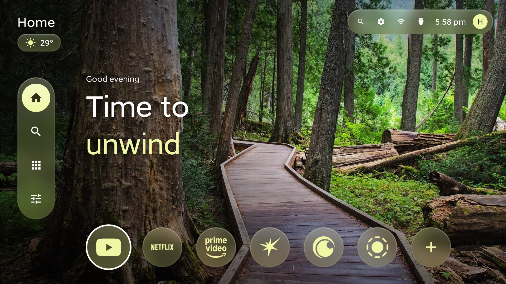
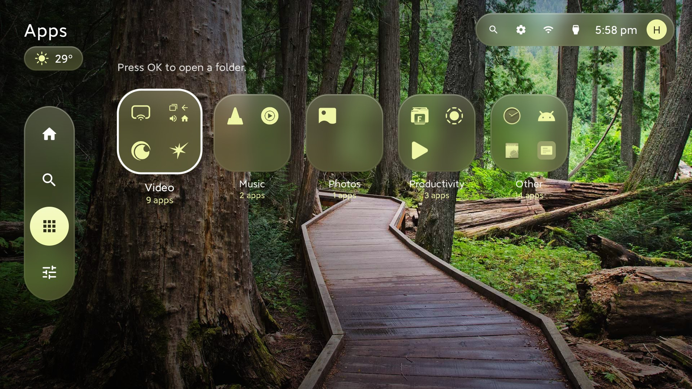
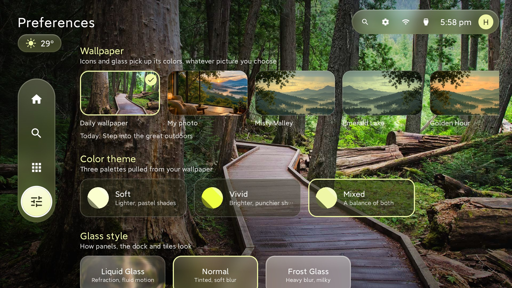

# Unwind Launcher

A calmer home screen for Android TV.

I wanted a TV home screen that felt like it belonged in a quiet room, so I built one. You pick a wallpaper, and the colors, icons and glass follow it. Nothing else on screen is shouting at you.

I made it on a 55-inch Xiaomi TV and that is where it's been tested most.

| Clear | Tinted |
|---|---|
|  |  |

| Clear, amber wallpaper | Preferences |
|---|---|
|  |  |

| Home with weather | App folders |
|---|---|
|  |  |

| Color themes in Preferences |
|---|
|  |

## What it does

- **Three glass styles.** Clear, Tinted and Frosted.
- **Wallpaper-driven colors.** Pick one of six built-in wallpapers, the daily wallpaper, or a photo of your own. The palette comes from the image, in Soft, Vivid or Mixed.
- **Weather.** Current conditions and a five-day forecast. It finds your location on its own, or you can pick a city.
- **App drawer.** An alphabetical grid, or automatic folders (Video, Music, Games and so on). It also shows apps most TV launchers hide, like sideloaded phone apps.
- **Home layout.** One endless row or stacked rows, with an optional glass dock.
- **Your own greetings** for morning, afternoon, evening and night.
- **Made for a remote.** D-pad focus everywhere, and search uses the TV's own keyboard.

## Glass styles

- **Clear:** see-through glass over a lightly blurred slice of your wallpaper, with a soft shadow underneath.
- **Tinted:** a blurred panel tinted with the wallpaper's colors.
- **Frosted:** a heavier, milkier blur.

Text and icons check the wallpaper behind them and switch between light and dark so they stay readable on any image.

## Install

There are two versions of Unwind. They look and work the same, and only differ in how they update.

**F-Droid version** (once it's listed): search for Unwind Launcher in the F-Droid app, or open
[f-droid.org/packages/com.unwind.launcher](https://f-droid.org/packages/com.unwind.launcher/).
Updates come through F-Droid. In Unwind, Preferences > About checks F-Droid for a newer version and opens its page. This version has no installer inside it.

**GitHub version:**

1. Download the latest APK from [Releases](../../releases).
2. Sideload it onto your TV.

This version updates itself: Preferences > About checks GitHub, downloads the new APK and installs it. Android asks you once to allow installs from Unwind.

The two versions are signed with different keys (yours on GitHub, F-Droid's on F-Droid), so Android won't let one install over the other. To switch, uninstall first. You can save your settings under Preferences > Backup before you do.

### Making it your Home screen

Press the Home button and choose Unwind, then **Always**. If nothing asks, open Preferences and tap **Open Home settings**.

Some TVs, certain Xiaomi models included, lock the Home button to their own launcher. If yours does, you can set Unwind as Home over ADB:

1. On the TV, go to **Settings → Device Preferences → About** and press Build seven times to turn on Developer options.
2. Turn on network or USB debugging.
3. From a computer:

```bash
adb connect <TV-IP-address>
adb shell cmd package set-home-activity com.unwind.launcher/.MainActivity
```

To undo it, uninstall Unwind:

```bash
adb uninstall com.unwind.launcher
```

## Preferences

| Setting | Options |
|---|---|
| Wallpaper | Daily wallpaper, your photo, six built-in |
| Palette | Soft, Vivid, Mixed |
| Glass | Clear, Tinted, Frosted |
| Icon shape | Circle, Squircle, Rounded, Hexagon |
| Icon colors | Themed or original |
| Home layout | Endless row or stacked rows |
| Glass dock | On or off, adjustable height |
| App drawer | Alphabetical or folders |
| App names | Show or hide on Home |
| Greetings | Your own text for each part of the day |

Your own wallpaper is copied into the launcher and scaled to the TV's resolution, so it survives if you unplug the USB drive.

## Permissions and privacy

- **Internet:** daily wallpaper (Bing), weather ([Open-Meteo](https://open-meteo.com/), no key or account), city lookup, release notes from GitHub for What's New, and the update check (against F-Droid in the F-Droid version, GitHub releases in the GitHub version).
- **Location and Wi-Fi state:** local weather and the nearby networks list. Android requires location access to scan for Wi-Fi.
- **Pictures and storage:** choosing a wallpaper from your TV.
- **Uninstall apps:** the Uninstall item in the long-press menu hands the app to Android's own uninstall screen.
- **Install unknown apps (GitHub version only):** lets Unwind install its own updates. The F-Droid version doesn't ask for this.

Weather uses the TV's last known location, with an IP-based fallback. Nothing is stored on a server or tracked by Unwind. There are no ads, analytics or crash reporters, and no Google services. The daily wallpaper and weather refresh when the launcher opens, then every 30 minutes.

## Built with

Kotlin and Jetpack Compose, with Material 3. No `androidx.tv`: D-pad focus and spring animations are written directly in Compose.

Kotlin 1.9.24 · Gradle 8.7 · AGP 8.5.2 · JDK 17 · `minSdk 24` · `targetSdk 34`

A few details:

- **Icons:** uses the monochrome or adaptive layers when an app provides them, so multicolor logos keep their detail. Older icons are separated from their backgrounds by luminance.
- **Colors:** the wallpaper is sampled on a 48 × 27 grid, weighted by saturation and brightness.
- **Weather icons:** drawn in Compose Canvas.
- **App discovery:** queries both TV and regular launcher activities.

## Known limits

- Some TV makers won't let you replace their Home screen. ADB usually gets around it.
- A few odd app icons can't be cleanly separated from their backgrounds and show as two-tone tiles.
- Input switching depends on how the TV maker implemented `TvInputManager`.
- Phone apps built for touch can be awkward with a remote.

## Next

Reordering pinned apps, custom folders you can name, more glass and icon styles, and more top bar layouts.

## License

[MIT](LICENSE)

Built with love, and some coding here and there by Hazir from 🇮🇳

The six built-in wallpapers are AI-generated.
