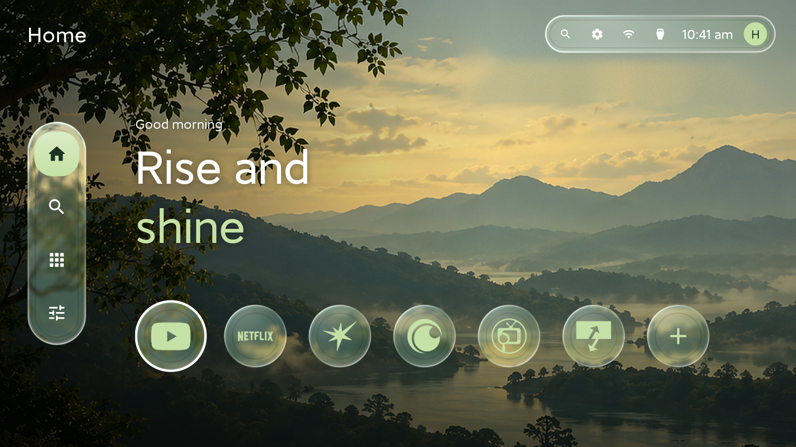
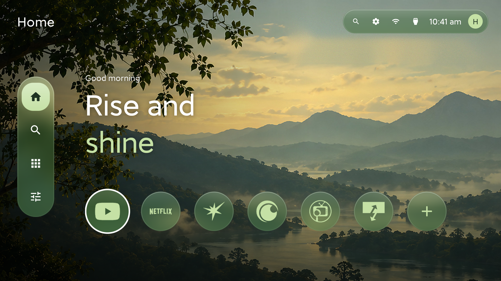
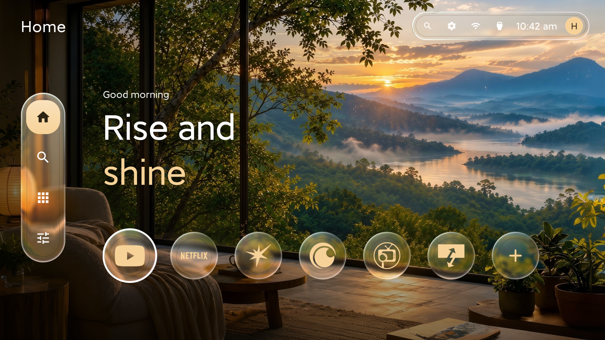
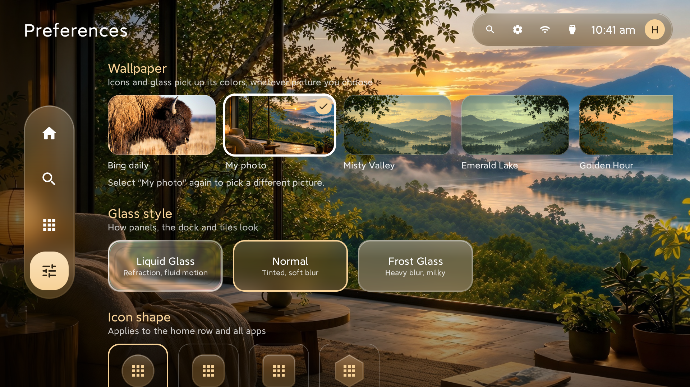

# Unwind Launcher

A calmer home screen for Android TV.

I wanted a TV home screen that felt like it belonged in a quiet room, so I built one. You pick a wallpaper, and the colors, icons and glass follow it. Nothing else on screen is shouting at you.

I made it on a 55-inch Xiaomi TV and that is where it's been tested most.

| Liquid Glass | Normal |
|---|---|
|  |  |

| Liquid Glass, amber wallpaper | Preferences |
|---|---|
|  |  |

| Home with weather | App folders |
|---|---|
|  |  |

| Color themes in Preferences |
|---|
|  |

## What it does

- **Three glass styles.** Liquid Glass, Normal and Frost.
- **Wallpaper-driven colors.** Pick one of six built-in wallpapers, the daily wallpaper, or a photo of your own. The palette comes from the image, in Soft, Vivid or Mixed.
- **Weather.** Current conditions and a five-day forecast. It finds your location on its own, or you can pick a city.
- **App drawer.** An alphabetical grid, or automatic folders (Video, Music, Games and so on). It also shows apps most TV launchers hide, like sideloaded phone apps.
- **Home layout.** One endless row or stacked rows, with an optional glass dock.
- **Your own greetings** for morning, afternoon, evening and night.
- **Made for a remote.** D-pad focus everywhere, and search uses the TV's own keyboard.

## Liquid Glass

Each piece of glass bends the wallpaper behind it at the edges, the way a thick pane would. There's a thin bright rim, a faint color split along the edge, and a soft shadow underneath. Text and icons check the wallpaper behind them and switch between light and dark so they stay readable on any image.

Normal and Frost are simpler: a blurred, tinted panel, and a heavier, milkier one.

Liquid Glass is drawn on the CPU, so a very busy page can take a moment to fill in the first time you see it. Baking runs on background threads so the interface stays responsive in the meantime.

## Install

1. Download the latest APK from [Releases](../../releases).
2. Sideload it onto your TV.

New builds install over old ones and keep your settings. The APK is signed with a personal key kept in GitHub Secrets. It's fine for sideloading, not for the Play Store.

### Making it your Home screen

Press the Home button and choose Unwind, then **Always**. If nothing asks, open Preferences and tap **Open Home settings**.

Some TVs, certain Xiaomi models included, lock the Home button to their own launcher. If yours does, you can set Unwind as Home over ADB:

1. On the TV, go to **Settings → Device Preferences → About** and press Build seven times to turn on Developer options.
2. Turn on network or USB debugging.
3. From a computer:

```bash
adb connect <TV-IP-address>
adb shell cmd package set-home-activity com.unwind.launcher/.MainActivity
```

To undo it, uninstall Unwind:

```bash
adb uninstall com.unwind.launcher
```

## Preferences

| Setting | Options |
|---|---|
| Wallpaper | Daily wallpaper, your photo, six built-in |
| Palette | Soft, Vivid, Mixed |
| Glass | Liquid, Normal, Frost |
| Icon shape | Circle, Squircle, Rounded, Hexagon |
| Icon colors | Themed or original |
| Home layout | Endless row or stacked rows |
| Glass dock | On or off, adjustable height |
| App drawer | Alphabetical or folders |
| App names | Show or hide on Home |
| Greetings | Your own text for each part of the day |

Your own wallpaper is copied into the launcher and scaled to the TV's resolution, so it survives if you unplug the USB drive.

## Permissions and privacy

- **Internet:** daily wallpaper, weather (Open-Meteo, no key or account) and city lookup.
- **Location and Wi-Fi state:** local weather and the nearby networks list. Android requires location access to scan for Wi-Fi.
- **Pictures and storage:** choosing a wallpaper from your TV.
- **Accounts and contacts:** showing your Google account name and photo.

Weather uses the TV's last known location, with an IP-based fallback. Nothing is stored on a server or tracked by Unwind. The daily wallpaper and weather refresh when the launcher opens, then every 30 minutes.

## Built with

Kotlin and Jetpack Compose, with Material 3. No `androidx.tv`: D-pad focus and spring animations are written directly in Compose.

Kotlin 1.9.24 · Gradle 8.7 · AGP 8.5.2 · JDK 17 · `minSdk 24` · `targetSdk 34`

A few details:

- **Icons:** uses the monochrome or adaptive layers when an app provides them, so multicolor logos keep their detail. Older icons are separated from their backgrounds by luminance.
- **Colors:** the wallpaper is sampled on a 48 × 27 grid, weighted by saturation and brightness.
- **Weather icons:** drawn in Compose Canvas.
- **App discovery:** queries both TV and regular launcher activities.

## Known limits

- Some TV makers won't let you replace their Home screen. ADB usually gets around it.
- A few odd app icons can't be cleanly separated from their backgrounds and show as two-tone tiles.
- Input switching depends on how the TV maker implemented `TvInputManager`.
- Phone apps built for touch can be awkward with a remote.

## Next

Reordering pinned apps, custom folders you can name, more glass and icon styles, and more top bar layouts.

## License

[MIT](LICENSE)

Built with love, and some coding here and there by Hazir from 🇮🇳
