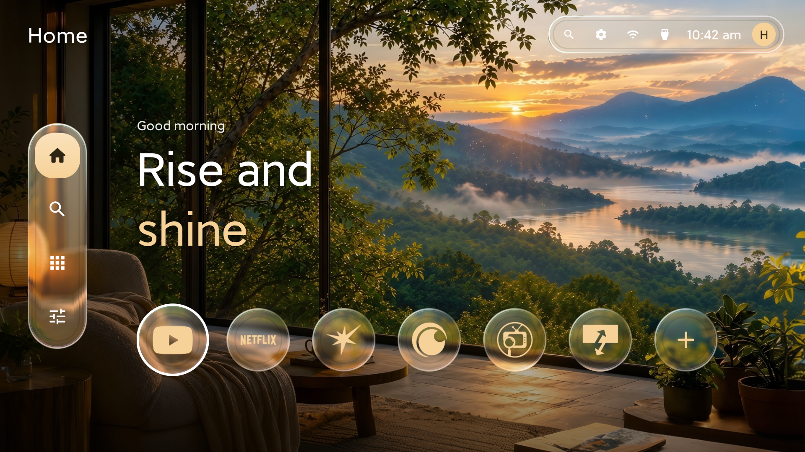
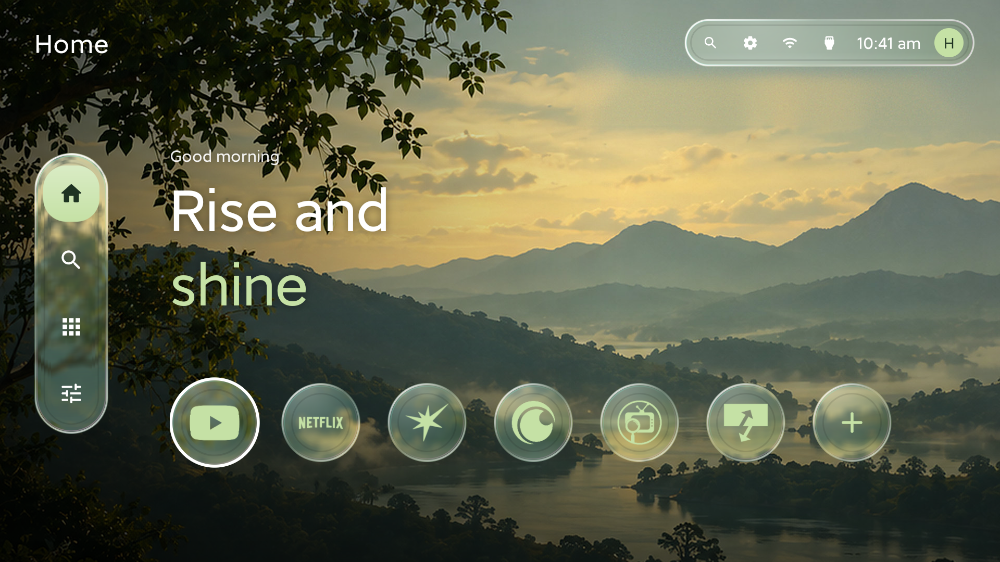
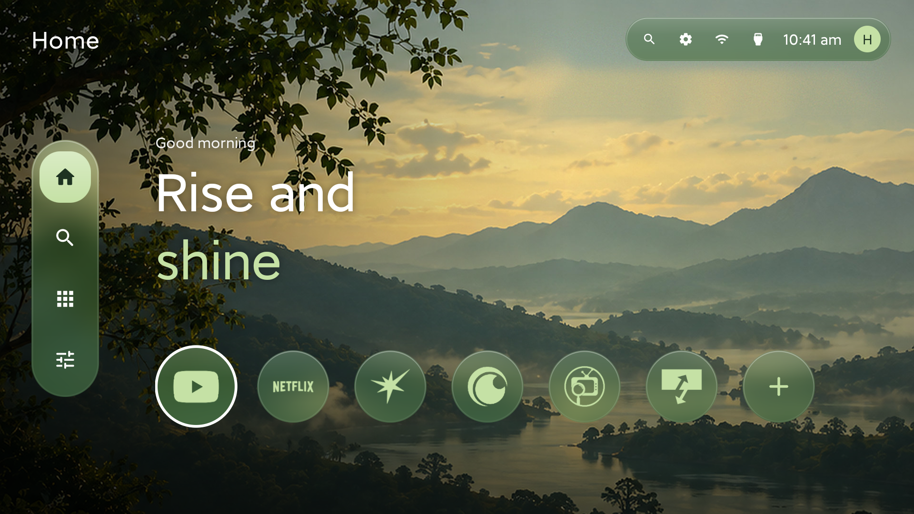
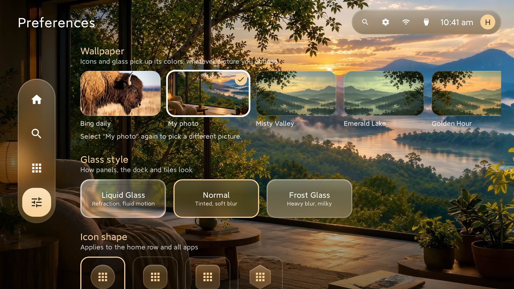

# Unwind Launcher

A custom home screen for Android TV. Frosted glass panels sit on top of your wallpaper, and the icons, glass and highlights all take their colors from whatever picture you pick.

  

I run it on a 55-inch Xiaomi TV, so that's where most of the testing happened.

## Screenshots

Same home screen, two wallpapers, two glass styles. The colors change on their own when the wallpaper does.

<table>
  <tr>
    <td></td>
    <td></td>
  </tr>
  <tr>
    <td align="center">Liquid Glass, Misty Valley wallpaper</td>
    <td align="center">Normal glass, Misty Valley wallpaper</td>
  </tr>
  <tr>
    <td></td>
    <td></td>
  </tr>
  <tr>
    <td align="center">Liquid Glass, my own photo</td>
    <td align="center">Normal glass, my own photo</td>
  </tr>
</table>

And the Preferences page, where you pick the wallpaper, glass style and icon shape:

  

## What you get

There are three glass styles: Liquid Glass, Normal and Frost Glass. Normal is a tinted, softly blurred panel. Frost Glass is a heavier, milkier blur. Liquid Glass is the fancy one. It bends the wallpaper at the edges the way a real piece of glass would, adds a bit of edge light and a rainbow fringe, and swells with a springy motion when you focus on it.

For wallpapers you can use one of the six that come with it, the daily wallpaper, or your own picture from the TV or a USB drive.

App icons get recolored to match the wallpaper. The logo is pulled off its background at high resolution and tinted. If an icon can't be separated cleanly, it shows up as a two-tone chip so it still fits in. You can switch to Original if you'd rather have the full-color icons. Icon shapes are Circle, Squircle, Rounded and Hexagon, and you can hide the app names on Home.

The top-left corner always tells you where you are: Home, Search, Apps, Favorites or Preferences.

Day to day:

- Home has a row of pinned apps, plus an Add apps tile for choosing them.
- The All apps page includes sideloaded phone apps like Google Photos, which most TV launchers hide. In Preferences you can switch it to folders (Video, Music, Games and so on, sorted by each app's category). Hold OK on an app inside a folder to move it somewhere else.
- Search is an on-screen keyboard that filters your installed apps as you type.
- The top bar has system settings, a list of every nearby Wi-Fi network (with signal strength and band), TV inputs, the clock, and your Google account.
- The D-pad moves between the dock, the top bar and your apps, in both directions.
- Home layout is your call: one endless row that scrolls sideways, or rows that fill the screen width and then wrap below. Either way you can turn on a glass dock behind the first row, in whichever glass style you picked, and set how low the dock sits on the screen.
- The greeting on Home (the "Rise and shine" bit) can be rewritten for morning, afternoon, evening and night from Preferences.
- A short welcome screen shows the first time Unwind opens. You can replay it from the bottom of Preferences.

## Getting the APK

Download the latest `app-debug.apk` from the [Releases page](https://github.com/hazir6677/The-Unwind-Launcher/releases) and sideload it onto your TV.

The APK is signed with a fixed key that lives in this repo's GitHub Secrets (never in the code), so each new build installs over the old one and keeps your settings. It's a personal sideload key, so it won't go on the Play Store as is.

## Making it your Home screen

Press the Home button on your remote. If the TV asks which Home app to use, pick Unwind and choose Always.

If it doesn't ask, open Preferences in Unwind, scroll to the bottom and tap Open Home settings, then pick Unwind from there.

To go back, pick your TV's original Home app in the same place, or just uninstall Unwind.

Some TVs lock the Home button to their built-in screen. Xiaomi does this on some models. If yours does, Unwind still works as a regular app, and you can force it with ADB:

1. On the TV, go to Settings > Device Preferences > About and press Build seven times to unlock Developer options. Then turn on Network debugging (or USB debugging).
2. On a computer with ADB, connect: `adb connect <TV-IP-address>`
3. Run: `adb shell cmd package set-home-activity com.unwind.launcher/.MainActivity`

To undo it, uninstall Unwind: `adb uninstall com.unwind.launcher`

## Finding your way around

The dock on the left has four buttons: house for Home, magnifier for search, grid for all apps, sliders for Preferences.

The pill in the top right has the same search shortcut, a gear for Android system settings, Wi-Fi (the connected network is highlighted), an HDMI icon for switching inputs, the clock, and an avatar showing which Google account is signed in.

## Preferences

- Wallpaper: Daily wallpaper, My photo, or one of the six stock wallpapers
- Glass style: Liquid Glass, Normal, Frost Glass
- Icon shape: Circle, Squircle, Rounded, Hexagon
- Icon style: Themed or Original
- App names: on or off
- Home screen: a short guide and a shortcut to the Home settings

For your own picture, choose My photo, then pick from the list of pictures on the TV or USB drive (or tap Browse files). The picture gets copied into the launcher, so it stays even if you delete the original. Tap My photo again any time to choose a different one.

Daily wallpaper needs internet. It checks when the launcher opens and every half hour after that, and only downloads when there's a new picture.

## Permissions

- Internet: to download the daily wallpaper.
- Location and Wi-Fi state: Android won't let an app list nearby Wi-Fi networks without location access. Nothing is stored or sent anywhere.
- Pictures and storage: only to show your pictures when you pick a wallpaper. It asks the first time you open the picker.
- Accounts and contacts: only to show which Google account is signed in.

## How it works

**Glass.** Each wallpaper is blurred ahead of time at three strengths and cut to the shape of whatever's being drawn. Normal and Frost just draw the matching blurred slice behind a tint. Liquid Glass stacks six thin lens bands. The outer rim pulls in wallpaper from outside the shape, which is what the edge of a real glass does. Each band further in does a little less of that, and the center magnifies slightly. It's all anti-aliased paths, so edges stay smooth as things scale.

**Icons.** Modern Android icons come in layers, and the foreground layer is exactly the logo, so that's what gets used. Older icons are analyzed by color, including logos sitting on a tile inside the icon. The logo is shrunk in halves down to the size it's shown at, which avoids jagged edges on a big screen.

**Colors.** The wallpaper is sampled for its dominant hue, and the accent, glass tint and dark shade come from that. Bright pictures get a stronger dark overlay so the text stays readable.

**Apps.** It lists both TV apps and regular phone apps, which is why sideloaded phone apps show up in the grid.

## Tech

Kotlin 1.9 and Jetpack Compose (BOM 2024.06), Material 3 with extended icons, Android Gradle Plugin 8.5, Gradle 8.7, JDK 17. minSdk 24, targetSdk 34. No `androidx.tv` dependency.

## Known problems

- Some TVs, including some Xiaomi models, lock the Home button to their own home screen. Unwind still works as an app there.
- A few unusual icons can't be separated from their background, so they show as two-tone chips.
- Switching inputs goes through the TV's own Live TV app, so how well it works depends on the brand.
- Sideloaded phone apps are built for touch, and some are hard to use with a remote.

## Maybe later

- Reordering pinned apps
- More glass and icon styles
- Top bar layout options

## License

MIT. See `LICENSE`.
